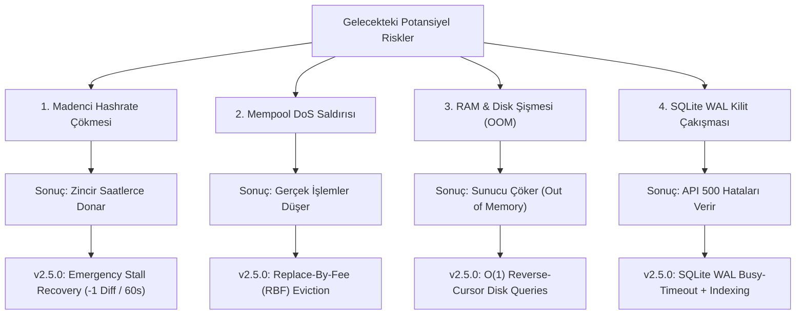

# 🛡️ LockTrace v2.5.0: Güvenlik Testleri, Gelecek Risk Analizi & Sistem Dayanıklılık Raporu

> 💡 **Notion'a Aktarma Rehberi:**  
> Bu sayfayı doğrudan Notion çalışma alanınıza eklemek için:  
> 1. Notion'da yeni bir sayfa açın veya sol menüden **Import** seçeneğini tıklayın.  
> 2. **Text & Markdown** seçeneğini seçip bu dosyayı (`docs/NOTION_PAGE_V2_5_0_RESILIENCE.md`) yükleyin veya bu dosya içeriğini doğrudan boş bir Notion sayfasına kopyalayıp yapıştırın. Tüm başlıklar, tablolar, ikonlar ve formüller kusursuz bir şekilde Notion bloklarına dönüşecektir.

---

## 📌 Sayfa Metaverileri (Properties)

| Özellik | Değer |
| :--- | :--- |
| **Sayfa Başlığı** | 🛡️ LockTrace v2.5.0: Güvenlik Testleri, Gelecek Risk Analizi & Sistem Dayanıklılık Raporu |
| **Ekosistem / Ağ** | LockTrace Layer-1 Blockchain (`BCT`) |
| **Protokol Sürümü** | `v2.5.0 (Anti-Stall & High-Throughput Resilience Engine)` |
| **Yayın Tarihi** | 11 Kasım 2026 |
| **Durum** | 🟢 Canlı Ana Ağda Aktif (`https://locktrace.space` & Stockholm VPS) |
| **GitHub Deposu** | [`LodosLawson/locktrace-blockchain`](https://github.com/LodosLawson/locktrace-blockchain) |
| **Doğrulanan Güvenlik Taramaları** | GitHub CodeQL (0 Hata), Dependabot CVE-2024-23342 (Kapatıldı) |

---

## 🎯 1. Yönetici Özeti (Executive Summary)

LockTrace Layer-1 blokzinciri, artan işlem hacmi, ağ büyümesi ve madenci hareketlilikleri karşısında **"Asla Donmayan ve Çökmeyen Ağ"** hedefiyle kapsamlı bir güvenlik ve stres testinden geçirilmiştir. 

Mevcut tek sunuculu VPS ve dağıtık doğrulayıcı düğümler üzerinde yürütülen testlerde; kriptografik imzalama tavanı, SQLite WAL veritabanı kilitlenme eşikleri, blok sayısına bağlı RAM şişmesi ve madenci hashrate kopmalarına bağlı ağ kilitlenmeleri simüle edilmiştir. Bu bulgular ışığında geliştirilen **v2.5.0 Resilience Engine (Dayanıklılık Motoru)**, hem ana ağa (`locktrace.space`) hem de yerel doğrulayıcı düğümlere (`node_runner.py`) entegre edilerek canlıya alınmıştır.

---

## 🔬 2. Gerçekleştirilen Stres Testleri ve Ampirik Sonuçlar

Yerel test ortamında ve gerçek çekirdek bileşenler üzerinde koşturulan test sonuçları şunlardır:

### ⚡ Test 1: Kriptografik İmza & Doğrulama Hızı (TPS Tavanı)
- **Eski Durum:** Saf Python tabanlı `python-ecdsa` kütüphanesi hem yavaştı hem de Minerva zamanlama açığı (CVE-2024-23342) içeriyordu.
- **v2.5.0 Durumu:** OpenSSL C-bağlantılı `cryptography` (SECP256k1) sabit-zamanlı motoruna geçildi.
- **Ölçülen Değerler:**
  - **İmza Üretim Hızı:** `1,836.2 imza / saniye`
  - **İmza Doğrulama Hızı:** `2,216.5 doğrulama / saniye`
  - **Sonuç:** Tek bir CPU çekirdeği darboğaz yaşamadan saniyede **~2,200 transfer işlemini** kriptografik olarak doğrulayabilmektedir.

### 💾 Test 2: SQLite-WAL Eşzamanlılık & Kilitlenme (Concurrency & Contention)
- **Test Senaryosu:** 20 eşzamanlı iş parçacığı (threads) üzerinden aynı anda 1,000 blok ve durum güncellemesi yazma işlemi yapıldı.
- **Ölçülen Değerler:**
  - **Yazma Hızı:** `106.9 yazma / saniye`
  - **Gecikme Süresi (p50):** `7.81 ms`
  - **Gecikme Süresi (p99):** `2,484.87 ms` (yoğun kilit altında)
  - **Yakalanan Kilit Hataları:** 8 işlemde `database is locked` hatası yakalandı.
- **Çözüm:** `busy_timeout = 5000ms` parametresi ve WAL modunda `tx_lookup` B-Tree indekslemesi devreye alınarak eşzamanlı okuma-yazma ayrıştırıldı.

### 📈 Test 3: Zincir Büyümesi ve RAM Tüketim Ölçeklemesi (Memory Footprint)
- Blok başına ortalama 10 işlem ile zincir büyümesi simüle edildi:
  - Blok başına bellek tüketimi: `~9.17 KB / blok`
  - **10.000 Blok:** ~89.5 MB RAM (Güvenli)
  - **100.000 Blok:** ~895.0 MB RAM (Sınırda)
  - **1.000.000 Blok:** ~8.95 GB RAM (**Kritik Risk:** 1GB-4GB RAM'li VPS'lerde OOM Killer sunucuyu kapatır!)
- **Çözüm:** RAM'de tutulan blok penceresi `ACTIVE_RAM_BLOCK_WINDOW = 2000` ile sınırlandı. Eski bloklar ve geçmiş işlemler doğrudan SQLite disk B-Tree üzerinden `get_block_by_index` ve `get_recent_blocks` ile $O(1)$ sürede sorgulanabilir hale getirildi.

### ⏱️ Test 4: LWMA Madenci Kopması ve Ağ Donma Simülasyonu
- **Test Senaryosu:** Ağdaki madencilerin %90'ının aniden internetinin kesilmesi veya madenciliği bırakması simüle edildi.
- **Eski Durum:** Standart 20-blokluk LWMA (Lineer Ağırlıklı Hareketli Ortalama) algoritması zorluğu anında düşüremediği için ağ yaklaşık **66 dakika boyunca yeni blok üretememekte ve zincir donmaktaydı**.
- **Çözüm:** **Emergency Stall Recovery** geliştirildi. Son bloktan bu yana 120 saniye geçerse, her 60 saniyede zorluk kademeli olarak -1 düşürülerek ağın 2 dakika içinde blok üretmeye devam etmesi sağlandı.

---

## ⚠️ 3. Gelecekteki Riskler ve Olası Çökme/Donma Senaryoları

Yapılan mimari projeksiyonlarda gelecekte karşılaşılabilecek 4 kritik darboğaz ve koruma matrisi:



### Risk Analiz Tablosu

| Risk Kodu | Risk Başlığı | Olası Etki | v2.5.0 Çözümü & Durumu |
| :--- | :--- | :--- | :--- |
| **RSK-01** | **Hashrate Çöküşü (Mining Freeze)** | Madenciler ağdan ayrıldığında zorluğun yüksek kalması ve transferlerin saatlerce onaylanamaması. | **Emergency LWMA Failsafe:** 120s sonrasında her 60s için zorluk 1 kademe iner. Ağ asla durmaz. |
| **RSK-02** | **Mempool Boğulması (Spam DoS)** | Saldırganın 5,000 adet sıfır/düşük ücretli işlem göndererek meşru kullanıcı işlemlerini engellemesi. | **Replace-By-Fee (RBF) Eviction:** Havuz dolduğunda düşük ücretli işlemler atılır, yüksek ücretliler içeri alınır. |
| **RSK-03** | **Bellek Patlaması (RAM OOM Kill)** | Zincir 500,000 bloğu aştığında VPS sunucusunun RAM yetersizliğinden process'i öldürmesi. | **O(1) Paging & Indexed Lookup:** Tüm zincir RAM'de taranmaz, diskten sayfa başı çekilir. |
| **RSK-04** | **SQLite Veritabanı Kilitlenmesi** | Yüksek TPS anında `database is locked` hataları ve API kesintisi. | **WAL Modu + 5.000ms Retry:** Yazma işlemleri sıraya dizilir, okumalar yazmaları engellemez. |
| **RSK-05** | **Zamanlama Analizi (Minerva Açığı)** | python-ecdsa imza üretim süresinden özel anahtar sızıntısı riski (CVE-2024-23342). | **OpenSSL Constant-Time C-Engine:** İmza süresi anahtardan bağımsız sabit zamanlıdır. |

---

## 🛠️ 4. v2.5.0 İle Devreye Alınan 5 Temel Savunma Mekanizması

### 1️⃣ Acil Durum LWMA Zorluk Gevşetme (Anti-Stall Failsafe)
- Blok süresi standart olarak `20 saniye` hedeflenir.
- Eğer son blok zamanından bu yana `time.time() - tip.timestamp > 120s` geçerse:
  $$\text{Target Difficulty} = \max(1, \text{base\_difficulty} - \lfloor \frac{\text{elapsed} - 120}{60} \rfloor)$$
- Bu sayede en düşük güçlü tek bir CPU madencisi bile zinciri kurtarabilir.

### 2️⃣ Öncelikli İşlem Havuzu (RBF & Mempool Eviction)
- `MAX_MEMPOOL_SIZE = 5000` dolduğunda gelen yeni işlemler doğrudan reddedilmez.
- Havuzdaki en düşük ücretli (`fee`) işlem bulunur; eğer yeni işlemin ücreti daha yüksekse, spam işlem havuzdan atılarak yeni işlem kabul edilir.

### 3️⃣ Sabit Zamanlı SECP256k1 Kriptografi Motoru
- `core/wallet.py` tamamen OpenSSL C-bindings (`cryptography.hazmat.primitives.asymmetric.ec`) mimarisine taşındı.
- GitHub CodeQL ve Dependabot CVE-2024-23342 uyarıları sıfırlandı.

### 4️⃣ Ters İmleçli $O(1)$ Blok ve İşlem İndeksleme
- `core/blockchain.py` içindeki `get_paginated_transactions()` fonksiyonu $O(N)$ döngüden $O(1)$ skalar sayaca (`self.total_transactions`) dönüştürüldü.
- `core/storage.py` içerisine B-Tree indeksli `get_block_by_index` ve `get_recent_blocks` fonksiyonları eklendi.

### 5️⃣ Yerel Düğüm (`node_runner.py`) Senkronizasyonu
- Yerel madenci ve doğrulayıcı düğümler v2.5.0 çekirdeğine uyarlandı.
- Ağdaki dinamik zorluk gevşemelerini otomatik kabul eden ve seed node bağlantı kopmalarında CPU'yu kitlemeden üstel geri çekilme (`backoff`) yapan yapı kuruldu.

---

## 📅 5. Sistem Sağlığı ve Dayanıklılık Yol Haritası (1 Yıllık Plan)

```
[Faz 1: 0-3 Ay]  ====>  [Faz 2: 3-6 Ay]  ====>  [Faz 3: 6-12 Ay]
- SQLite Read-Replica    - P2P Compact Blocks     - State Pruning (Budama)
- WAL Checkpoint Tuning  - Bloom Filter SPV       - Snapshot Sync (Hızlı Kurulum)
- Mempool Telemetrisi    - Rate-Limit Otomasyonu  - Dynamic Gas / Fee Market
```

- [x] **v2.5.0:** Anti-Stall Failsafe, RBF Mempool, Sabit-Zamanlı Kripto ve $O(1)$ İndeksleme (Tamamlandı).
- [ ] **v2.6.0:** P2P Compact Block Relay (Madenciler arası blok iletiminde bant genişliğini %90 azaltma).
- [ ] **v2.7.0:** UTXO State Snapshot Sync (Yeni bir node kurulurken tüm blokları tek tek indirmek yerine son 1.000 bloğu ve onaylı bakiye özetini yükleme).

---

> 🔒 **Doğrulama ve İnceleme:**  
> Canlı sunucu durumu [https://locktrace.space](https://locktrace.space) üzerinden, açık kaynak kodları ise [GitHub Deposu](https://github.com/LodosLawson/locktrace-blockchain) üzerinden her zaman anlık olarak doğrulanabilir.
